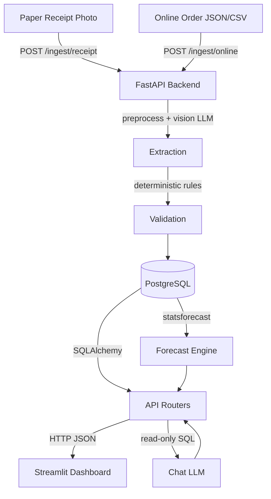

# scanota Architecture

## System Overview



## Components

| Component | Technology | Purpose |
|---|---|---|
| Backend | FastAPI + Uvicorn | REST API, business logic |
| Database | PostgreSQL 16 | Transactions, products, aliases |
| Extraction | Vision LLM (OpenAI-compat) | Receipt OCR |
| Preprocessing | OpenCV | Deskew, CLAHE, resize |
| Validation | Pure Python (rules.py) | Math checks, fuzzy matching |
| Forecast | statsforecast (Croston/TSB) | Demand forecast |
| Chat | Text LLM + sqlglot | Read-only text-to-SQL |
| Dashboard | Streamlit | Indonesian dark-green UI |
| Infra | vLLM on AMD ROCm | GPU inference |

## LLM vs Math Boundary

**LLMs read and explain. Math validates and predicts.**

- LLMs: extract text from receipt images, translate questions to SQL, rephrase explanations
- Math/deterministic: ALL validation rules, fuzzy matching scores, confidence scoring, forecasting, safety stock, reorder point calculations

## Security Layers

1. **SQL Guard** (`sqlglot` AST): blocks DML/DDL, restricts to 2 allowed views, deny-lists dangerous functions
2. **DB Read-only Role** (`scanota_ro`): `default_transaction_read_only=on`, SELECT only on `sales_flat` and `products_public`, `statement_timeout=5s`
3. **No secrets in repo**: all keys via env vars

## AMD Deployment

```
AMD Developer Cloud / Instinct GPU
  └── vLLM (ROCm) serving vision + text models
        ↑ OpenAI-compatible HTTP API
scanota backend (LLM_BASE_URL points to vLLM)
```

Switch from Tokenfactory to own vLLM: change `LLM_BASE_URL` in `.env` only.
