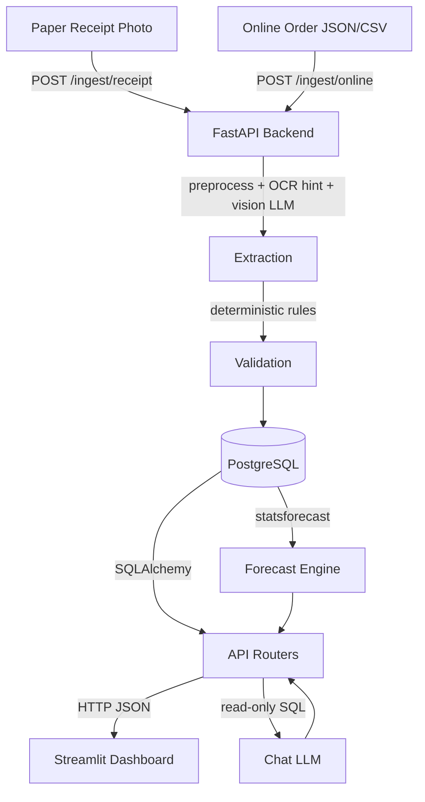

# scanota Architecture

## System Overview



## Components

| Component | Technology | Purpose |
|---|---|---|
| Backend | FastAPI + Uvicorn | REST API, business logic |
| Database | PostgreSQL 16 | Transactions, products, aliases |
| Extraction | Vision LLM (OpenAI-compat) + OCR endpoint | Receipt reading; the OCR text is a hint, the image stays the source of truth |
| Preprocessing | OpenCV | Deskew, CLAHE, resize |
| Validation | Pure Python (rules.py) | Math checks, fuzzy matching |
| Forecast | statsforecast (Croston/TSB) | Demand forecast |
| Chat | Text LLM + sqlglot | Read-only text-to-SQL |
| Dashboard | Streamlit | Indonesian and English dark-green UI |
| Inference | AMD Token Factory (OpenAI-compatible API) | Vision, text and OCR models |

## LLM vs Math Boundary

**LLMs read and explain. Math validates and predicts.**

- LLMs: extract text from receipt images, translate questions to SQL, rephrase explanations
- Math/deterministic: ALL validation rules, fuzzy matching scores, confidence scoring, forecasting, safety stock, reorder point calculations

## Security Layers

1. **SQL Guard** (`sqlglot` AST): blocks DML/DDL, restricts to 2 allowed views, deny-lists dangerous functions
2. **DB Read-only Role** (`scanota_ro`): `default_transaction_read_only=on`, SELECT only on `sales_flat` and `products_public`, `statement_timeout=5s`
3. **No secrets in repo**: all keys via env vars

## AMD Deployment

```
AMD Token Factory (AMD Radeon Cloud, AMD GPUs)
  ├── vision model (MiniCPM-V-4.7-35B-A3B, optional fallback DeepSeek-V4.1-Flash)
  ├── text model (Qwen3.8-27B)
  └── OCR model (MinerU2.5-Pro, POST /ocr)
        ↑ OpenAI-compatible HTTP API (LLM_BASE_URL, LLM_API_KEY)
scanota backend
```

`infra/amd/` holds an optional vLLM-on-ROCm overlay for self-hosting. The current setup does not
use it. To switch to your own vLLM, change `LLM_BASE_URL` (and the model names) in `.env` and set
`OCR_ENABLED=false`, because vLLM has no `/ocr` route. See `infra/amd/README.md`.

## Dashboard

- Streamlit multipage app: `dashboard/app.py` sets up the page and `st.navigation`; the pages are in `dashboard/views/`. Navigation is `st.navigation(position="hidden")` plus `st.page_link` buttons in the sidebar, rather than the `pages/` folder, so titles and icons follow the chosen language and the sidebar order is ours (brand, pages, language card, API status).
- **Language:** all text is in `dashboard/strings.py` (Indonesian default, English). The sidebar switch keeps the choice in the session and in `?lang=`. The API gets the language too: `/restock?lang=` returns the reason and shelf-life note in that language and `/chat` answers in it. Validation issues are shown with a translated label plus the engine's English detail. A test checks that both languages have the same keys and placeholders and that every validation issue code has a label.
- **Scan page:** upload files or use the device camera. The camera widget is created only when "Camera" is selected, so no permission prompt appears for visitors who upload. Both read from the visitor's browser, never from the server's disk. Each image is scanned once (results are kept by image hash), so a rerun caused by anything else cannot re-send a receipt to the model.
- **Loading and caching:** no page is ever left empty while it waits. Every call that can be slow runs inside `st.spinner` with its own message (Overview, Restock, Review for the list, the receipt and the confirm, Transactions, Ask and Scan for the model calls), and `app.py` shows "Loading the page..." while it checks the API (2 s at most, then cached for 10 s). `restock_cached` keeps the forecast for a minute (cleared after a stock update, a scan or a confirm). The forecast calls wait up to 120 s (`_FORECAST_TIMEOUT`), because a small VM can take far longer than the 30 s of an ordinary call. A test checks that each of these messages is wired into its page.
- **Ask page:** the query and its answer come in two calls, so a slow model never hides a result that is already known. `api.chat(..., answer=False)` returns the SQL and the rows; the page shows them at once, then `api.chat_answer` fetches the written answer (up to 90 s, `_ANSWER_TIMEOUT`) while a "Writing the summary..." message sits where the answer will be. If the answer is missing the page says so and keeps the table and the SQL. Each answer is fetched once; a rerun reuses it.
- **Layout of buttons:** the photo source switch is a two-column grid (equal buttons, full width on a phone, 520 px at most on a desktop). Rows of action buttons sit in a container whose key starts with `actions_`; the CSS in `theme.py` gives each button a readable width and lets the row wrap instead of squeezing the buttons, because Streamlit only stacks columns below 640 px.
- **Upload limit:** 10 MB per photo, set in three places that a test keeps equal: `server.maxUploadSize` in `dashboard/.streamlit/config.toml`, `MAX_UPLOAD_MB` in the API settings and `MAX_UPLOAD_MB` in `dashboard/helpers.py`. The reverse proxy allows 12 MB.
- **Toolbar:** `toolbarMode = "minimal"` hides the three-dot menu (Rerun, Settings, Print, Record a screencast, About) as well as the Deploy button.
- **Theme:** `dashboard/.streamlit/config.toml` and `dashboard/theme.py`. The sidebar has the same black as the page with a hairline border; containers are border-only (no fill) and only metrics, inputs and the active link have a fill, always padded and rounded. The brand is drawn in the sidebar header with CSS, not `st.logo`, which adds a second copy in the page header that overlaps the sidebar. Palette `#000000`, `#3e432e`, `#616f39`, `#a7d129`, plus amber and red used only to mean "watch" and "act now". No animations.

## Forecast Policy

- `statsforecast` (TSB / CrostonOptimized, chosen per SKU on a 4-week hold-out) forecasts weekly demand; short histories fall back to a 4-week moving average and `data_quality` says so.
- Safety stock is `z x sigma x sqrt(lead time weeks)`. Sigma is the RMSE of one-step forecast errors over the last 26 weeks (`SIGMA_LOOKBACK_WEEKS`). `python -m app.eval.backtest` (`make backtest`) scores this against alternatives on the history.
- z and shelf life are per category in `app/forecast/category_policy.py`: 2.2 for goods that keep (5% stockout target) and 1.8 for cement, paint and waterproofing (10% target). Categories not listed use `SAFETY_STOCK_Z` (2.2).
- **The demand model is cached by sales, not by time.** `cached_forecast` in `app/forecast/service.py` remembers each SKU's model result under a fingerprint of its weekly series (and the horizon), behind a lock. A stock update does not change the sales, so `/restock` after it only redoes the cheap stock-dependent math (about 0.1 s instead of about 4 s on a fast machine); a new sale recomputes only the SKUs whose series changed; requests that arrive together share one computation. Nothing needs invalidating, because a changed series is a different key. A failed model run (`fallback_reason == "error"`) is not kept. The cache lives in the API process, so the first `/restock` after a restart pays the full cost (about 5.5 s here).
- Shelf life: if today's stock would take longer to sell than the shelf life, `/restock` returns `shelf_life_risk` (`watch` above 70% of it, `high` above 100%) with a note, and caps the suggested order to what can sell before it spoils. This uses days of cover from the forecast; stock age is unknown because receiving dates are not recorded.

## LLM Call Policy

- **Token budget:** Qwen3.8-27B thinks at `xhigh` unless told otherwise. SQL generation uses
  `reasoning_effort=medium` with `max_tokens=2048`; answer phrasing and restock rephrasing use
  `low` with 1024 / 512 tokens (`LLM_*` in `.env`). Thinking counts toward `max_tokens`, so a
  reply cut off by the budget is logged as a warning. Qwen3.8-27B rejects `high` (400).
- **Retry:** 429, 5xx and connection errors are retried with exponential backoff and jitter
  (`app/llm.py`); a `Retry-After` header wins over the backoff. Tokenfactory answers its
  per-minute limits with `Retry-After: 60`, so `LLM_RETRY_MAX_SECONDS` must stay above 60.
  Timeouts are not retried. The optional restock rephrasing gives up at the first long 429
  instead of waiting. The dashboard's LLM-backed calls have a 300 s timeout to fit the waits.
- **Chat in two steps:** `POST /chat` runs the question to SQL, validates it, runs it and, unless `answer` is `false`, words the rows. `POST /chat/answer` (question, columns, rows up to the guard's 200, language) only words rows it is given. The wording is optional polish, so a timeout, a 429 or a 5xx there gives `answer: null` and a normal 200 instead of an error: the SQL and the rows were already good. It gets 30 s and one short retry (no 60 s `Retry-After` sleep).
- **Vision fallback:** if `LLM_MODEL_VISION` stays down (5xx after retries, or a timeout), the
  receipt is read by `LLM_MODEL_VISION_FALLBACK` instead (empty = off). 429s and connection
  errors do not switch models. The switch lasts for that receipt only; the next one tries the
  main model first.
- **Shared limits:** the whole team shares one key: 30 RPM per key, 20 RPM per account, 8
  concurrent. A receipt scan costs at least 2 requests (OCR + vision), a chat question at least 2.
- **OCR hint:** on Tokenfactory, `app/extraction/ocr.py` sends the receipt to the MinerU2.5-Pro
  OCR endpoint and passes its text to the vision model as a hint. The image stays the source of
  truth, and any OCR failure falls back to the vision model alone.
